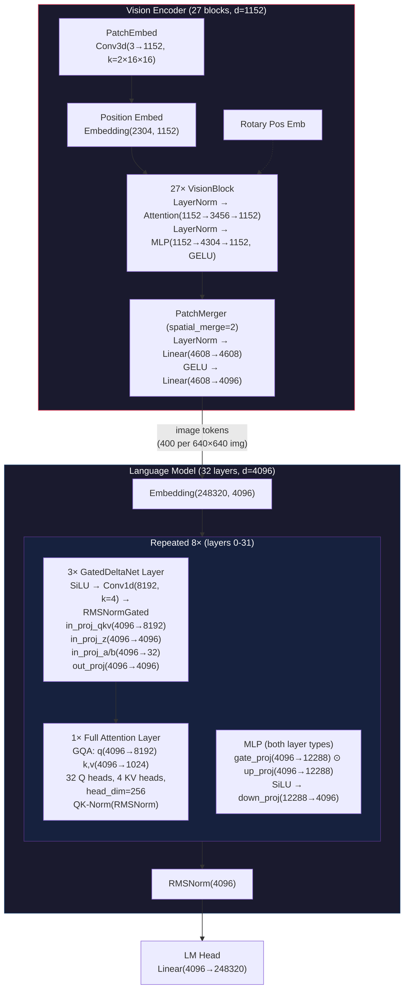

# VLLMs (Vision Language Models)

### Qwen3.5

The architecture of Qwen3.5 is different to older versions of Qwen, since the vision + text parts of the model are effectively combined right at the start of the model architecture.

We can dive into the layer types:

- Vision Encoder
    - This uses standard ViT blocks, which is Attention -> MLP over the image patches (produced by RoPE). These are repeated 27 times.
    - The "PatchMerger" does a "spatial merge" which concatenates groups of 2x2 spatially adjacent patches, and then are projected down to 4096 through a couple linear layers.
- The output vision embedding is combined with the text embedding, with the following pattern:
    - 3 layers of GatedDeltaNet - "LinearAttention", a novel architectuer which provides faster attention
    - 1 layer of full GQA, which is more precise.
- Finally, you have the LMHead which predicts the next token.

The GatedDeltaNet is interesting, essentiall you have the following:
    - The linear attention means keeping a fixed size matrix, and because it's fixed size, having to overwrite the data within it. This means you don't get a perfect lookup.
    - The Delta part means that rather than just adding the new value to the previous, the model adds the "corrections" e.g new value - old value, which means it performs clean overwrites, rather than adding noise.
    - Finally, the gated part is similar to an RNN, and controls how much of the old state should be forgotten, and what is the strength and which new states should be written.

The VisionEncoder itself  is a Conv3d PatchEmbed. The reason that we use 3d here instead of 2d is because this model supports video, so it actually produces a token per 16x16 pixel square for each 2 frames in the video.

## Videos / Talks

### Computer Vision in the Age of LLMs

[This is a talk](https://www.youtube.com/watch?v=kxO6ARgI_SU&t=974s) by Lucas Beyer.

>[!TODO]
> - [ ] Make notes on this talk.
